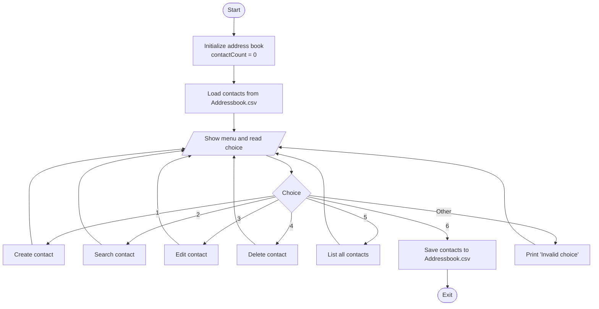
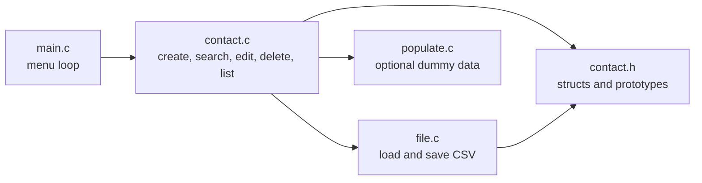

# Address Book in C

A menu-driven **contact management system** written in **C**. It lets you create, search, edit, delete and list contacts, and saves them to a **CSV file** so your data is still there the next time you run the program.

> Menu → Create / Search / Edit / Delete / List → Save to `Addressbook.csv`

---

## Table of Contents
- [Features](#features)
- [How It Works](#how-it-works)
- [Flowchart](#flowchart)
- [Project Structure](#project-structure)
- [Build and Run](#build-and-run)
- [Input / Output](#input--output)
- [Module Details](#module-details)
- [Limitations](#limitations)
- [Future Improvements](#future-improvements)
- [Concepts Used](#concepts-used)
- [Author](#author)

---

## Features
- **Create** a contact (name, phone, email)
- **Search** by name, phone or email
- **Edit** the name, phone or email of an existing contact
- **Delete** a contact (the remaining contacts shift up)
- **List** all contacts in a formatted table
- **Persistent storage**: contacts are loaded from and saved to `Addressbook.csv`
- Optional **dummy data** loader (`populate.c`) for testing
- Modular code split across separate `.c` / `.h` files

---

## How It Works

1. On startup, `initialize()` sets the contact count to 0 and loads any saved contacts from `Addressbook.csv`.
2. A menu loop in `main()` reads your choice and calls the matching function.
3. Contacts are stored in an `AddressBook` struct holding an array of up to **100** `Contact` records.
4. Choosing **Save and Exit** writes every contact back to `Addressbook.csv` in `name,phone,email` format.

---

## Flowchart



### Module interaction



---

## Project Structure

```
address-book-c/
├── main.c        # Entry point: menu loop
├── contact.c     # Contact operations (create, search, edit, delete, list)
├── contact.h     # Contact and AddressBook structs, function prototypes
├── file.c        # Save/load contacts to CSV
├── file.h        # File function prototypes
├── populate.c    # Optional dummy contacts for testing
├── populate.h
├── Addressbook.csv   # Saved contacts (created automatically)
└── README.md
```

---

## Build and Run

**Requirements:** GCC (or any C compiler)

```bash
# 1. Clone the repository
git clone https://github.com/<your-username>/<your-repo-name>.git
cd <your-repo-name>

# 2. Compile
gcc main.c contact.c file.c populate.c -o contact_app

# 3. Run
./contact_app          # Windows: contact_app.exe
```

---

## Input / Output

**Input**: menu choice (1-6), then the fields for the chosen action.

**Menu**
```
Address Book Menu:
1. Create contact
2. Search contact
3. Edit contact
4. Delete contact
5. List all contacts
6. Save and Exit
Enter your choice:
```

**Example: list output**
```
--------------------------------------------------------------------------------
| S.No  | Name                 | Phone           | Email                          |
--------------------------------------------------------------------------------
| 1     | Sai Kadam            | 8888888888      | sai@example.com                |
| 2     | Yash Patil           | 5555555555      | patil@example.com              |
--------------------------------------------------------------------------------
```

**Storage format (`Addressbook.csv`)**
```
Sai Kadam,8888888888,sai@example.com
Yash Patil,5555555555,patil@example.com
```

---

## Module Details

### `main.c`: Menu
- Calls `initialize()` once, then loops until the user picks **6**
- Uses a `switch` to dispatch to each contact function

### `contact.c`: Core Operations
- `createContact`: reads name, phone and email; rejects new entries when 100 contacts are stored
- `searchContact`: exact-match search by name, phone or email using `strcmp`
- `editContact`: finds a contact by name, then updates the chosen field
- `deleteContact`: removes a contact and shifts the later ones up by one
- `listContacts`: prints all contacts as a formatted table

### `file.c`: Persistence
- `saveContactsToFile`: writes every contact as `name,phone,email`
- `loadContactsFromFile`: reads the CSV back with `fscanf` and field-width limits

### `contact.h`: Data Structures
```c
typedef struct Contact {
    char name[50];
    char phone[20];
    char email[50];
} Contact;

typedef struct {
    Contact contacts[MAX_CONTACTS];   // MAX_CONTACTS = 100
    int contactCount;
} AddressBook;
```

---

## Limitations
- Holds at most **100** contacts (fixed-size array)
- Search, edit and delete use **exact, case-sensitive matches** and act on the first match only
- There is **no input validation** (phone format, email format, duplicates)
- Names containing a **comma** will break the CSV format
- Some `scanf("%s")` reads have no width limit, so very long input could overflow a field

---

## Future Improvements
- Validate phone numbers and email addresses, and block duplicates
- Case-insensitive and partial-match search
- Sort contacts by name
- Use dynamic memory (`malloc`/`realloc`) instead of a fixed array
- Safer input handling (`fgets` or width-limited `scanf`)
- Handle commas in names (quoted CSV fields)

---

## Concepts Used
- Structures and arrays of structures
- Pointers and passing structs by pointer
- Multi-file C programs with header files and include guards
- File handling (`fopen`, `fprintf`, `fscanf`, `fclose`)
- String handling (`strcmp`) and formatted output
- Menu-driven programs with `switch` and `do-while`

---

## Author
**Harsh Kadam**: Mechatronics Engineering student (MMIT, SPPU), interested in embedded systems, robotics, and semiconductors.

⭐ If you found this project useful, consider giving it a star!
